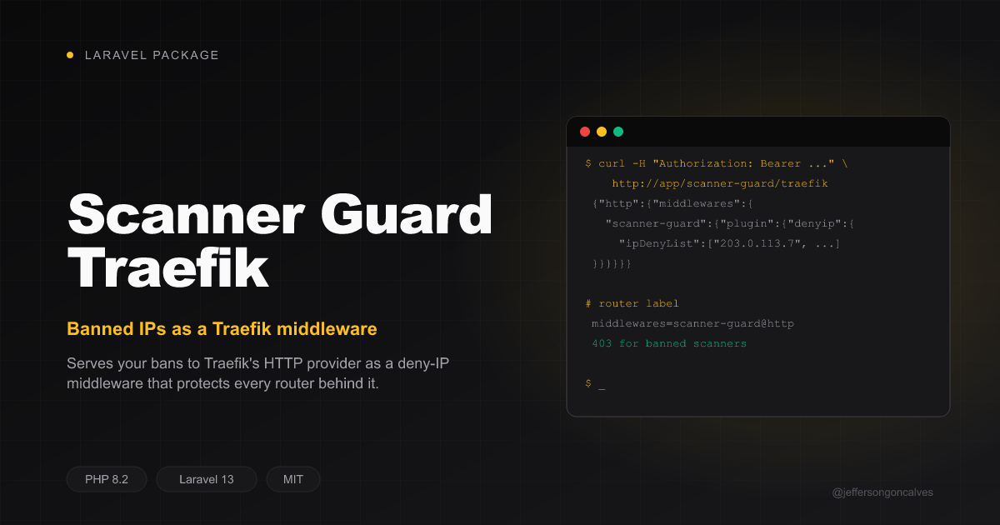

<div class="filament-hidden">



</div>

# Laravel Scanner Guard Traefik

[](https://packagist.org/packages/jeffersongoncalves/laravel-scanner-guard-traefik)
[](https://github.com/jeffersongoncalves/laravel-scanner-guard-traefik/actions/workflows/tests.yml)
[](https://packagist.org/packages/jeffersongoncalves/laravel-scanner-guard-traefik)

Traefik integration for [`laravel-scanner-guard`](https://github.com/jeffersongoncalves/laravel-scanner-guard).
Serves your bans and `ip_blocklist` to Traefik's [HTTP provider](https://doc.traefik.io/traefik/reference/install-configuration/providers/others/http/)
as a deny-IP middleware, so Traefik rejects banned scanners before they reach any app behind it.
One app's bans can protect every router that uses the middleware.

Traefik has no built-in IP *deny* middleware (only `ipAllowList`), so this uses the
[denyip](https://plugins.traefik.io/plugins/62947363ffc0cd18356a97d1/deny-ip-plugin) plugin. Traefik
pulls the list: nothing is pushed, so there is no sink to add to `scanner-guard.sinks`.

## Installation

```bash
composer require jeffersongoncalves/laravel-scanner-guard-traefik
```

```dotenv
SCANNER_GUARD_TRAEFIK_ENABLED=true
SCANNER_GUARD_TRAEFIK_TOKEN=a-long-random-token
```

This registers `GET /scanner-guard/traefik` (no session, no CSRF), which answers `403` unless the
request sends `Authorization: Bearer <token>`. The response carries raw IPs: keep the token secret.

```json
{"http":{"middlewares":{"scanner-guard":{"plugin":{"denyip":{"ipDenyList":["185.177.72.0/24","203.0.113.7"]}}}}}}
```

## Traefik setup

**Order matters.** A router that references a middleware Traefik can't build stops serving. Finish
steps 1–2, check the middleware is healthy, and only then attach it (step 3).

1. **Static configuration** (`traefik.yml`, or the matching CLI flags): declare the plugin and the
   HTTP provider, and trust your CDN's forwarded headers.

   ```yaml
   experimental:
     plugins:
       denyip:
         moduleName: github.com/kevtainer/denyip
         version: v1.0.0 # check the plugin catalog for the latest

   providers:
     http:
       # Reach the app directly over the Docker network, not through a Traefik router.
       endpoint: http://my-app-container/scanner-guard/traefik
       pollInterval: 30s
       headers:
         Authorization: Bearer a-long-random-token

   entryPoints:
     websecure:
       forwardedHeaders:
         # Behind Cloudflare: its ranges from https://www.cloudflare.com/ips/
         trustedIPs:
           - 173.245.48.0/20
           # ...
   ```

2. **Restart Traefik** and check its dashboard (or logs) for the `scanner-guard@http` middleware,
   with no plugin error.

3. **Attach the middleware** to each router, e.g. with Docker labels:

   ```yaml
   labels:
     - traefik.http.routers.my-app.middlewares=scanner-guard@http
   ```

### Behind Cloudflare (or any proxy)

denyip checks the connection's address **and every entry** of `X-Forwarded-For`. Cloudflare appends
the visitor's IP to `X-Forwarded-For`, so a banned visitor is blocked as long as Traefik keeps that
header: Traefik only trusts incoming forwarded headers from `forwardedHeaders.trustedIPs`, and
replaces them otherwise. Without the trusted ranges the plugin only ever sees Cloudflare's edge IP
and blocks nothing. A client spoofing `X-Forwarded-For` with a banned IP can only block itself.

### Why the list is never empty

denyip refuses to load with an empty list, or with one invalid entry, and that takes the routers
using it down. Entries come validated from scanner-guard, and with nothing banned the endpoint
serves `192.0.2.1` (TEST-NET-1, RFC 5737), which is never a real client.

## Configuration

```bash
php artisan vendor:publish --tag="laravel-scanner-guard-traefik-config"
```

| Key | Env | Default | |
|---|---|---|---|
| `enabled` | `SCANNER_GUARD_TRAEFIK_ENABLED` | `false` | registers the route |
| `path` | `SCANNER_GUARD_TRAEFIK_PATH` | `scanner-guard/traefik` | |
| `token` | `SCANNER_GUARD_TRAEFIK_TOKEN` | `null` | required; no token = always `403` |
| `middleware` | `SCANNER_GUARD_TRAEFIK_MIDDLEWARE` | `scanner-guard` | referenced as `scanner-guard@http` |
| `plugin` | `SCANNER_GUARD_TRAEFIK_PLUGIN` | `denyip` | key under `experimental.plugins` |
| `list_key` | `SCANNER_GUARD_TRAEFIK_LIST_KEY` | `ipDenyList` | the plugin's IP list option |
| `placeholder` | | `192.0.2.1` | served when nothing is banned |

Each poll reads the active bans (one query with the `database` driver), so keep `pollInterval` at
tens of seconds rather than Traefik's 5s default. On an `http` satellite the endpoint serves the
last pulled central list.

## Testing

```bash
composer test
```

## Changelog

Please see [CHANGELOG](CHANGELOG.md) for more information on what has changed recently.

## Credits

- [Jefferson Gonçalves](https://github.com/jeffersongoncalves)
- [All Contributors](../../contributors)

## License

The MIT License (MIT). Please see [License File](LICENSE.md) for more information.
